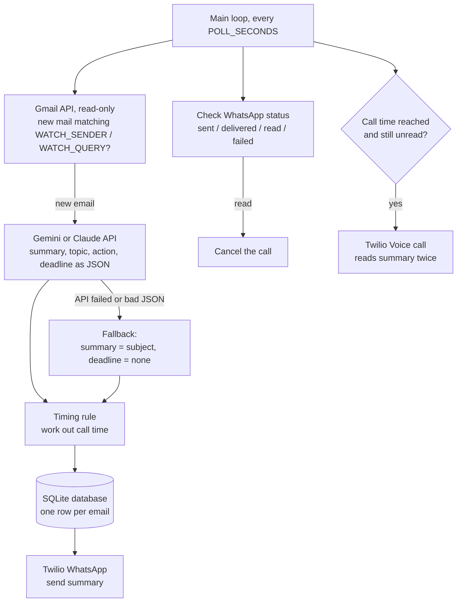

# gmail-deadline-alert

**Never miss an important email deadline again.** Watches your Gmail, lets an AI find the deadline,
and calls your phone (and optionally WhatsApps you) before it's too late.

  

This is a **general email alert system**. You choose which emails matter: a sender (like your college placement cell `careers@example.edu`), a whole domain (`@company.com`), or any Gmail search (`subject:interview`). You can use it for placements, job applications, college notices, exams, bills or anything else. When a matching email arrives it:

1. Asks an AI (**Google Gemini**, free tier, or **Claude**, paid) to read the email and pull out a short summary, what it's about, what you need to do, and the deadline.
2. Sends you a **WhatsApp** message with that info (through Twilio).
3. Keeps checking if you **read** the WhatsApp message (blue ticks).
4. If you still haven't read it when the deadline gets close, it **calls your phone** and reads the summary aloud in an Indian English voice.

It only *reads* your Gmail. It never marks emails as read, moves them or deletes them.

## Two ways to run it

| | **Free mode** | **Full mode** |
|---|---|---|
| AI that reads the email | Google Gemini (free tier) | Gemini or Claude |
| WhatsApp message | off | on |
| Phone call | yes, plays Twilio's demo voice (Twilio "Limited trial" can't speak custom text) | yes, reads your summary aloud twice |
| Call timing based on the real deadline | yes | yes |
| Cost | free (Twilio trial: 75 call minutes, 30 days) | pay as you go (Twilio, and Claude if you pick it) |
| Settings in `.env` | `AI_PROVIDER=gemini`, `WHATSAPP_ENABLED=false`, `TWILIO_CALL_URL=...` | `WHATSAPP_ENABLED=true`, `TWILIO_CALL_URL=` empty |

You can switch between them any time by editing `.env`. No code changes.

## Quick start (free mode, about 30 minutes)

1. **Install:** see [Install on your computer](#install-on-your-computer).
2. **Gmail:** create `credentials.json` ([step 1](#1-google-cloud-and-the-gmail-api)), then run `python -m app.main --auth`.
3. **Gemini key:** free from <https://aistudio.google.com/apikey> ([step 3](#3-ai-key-gemini-free-or-claude-paid)).
4. **Twilio trial:** sign up, verify your phone, note your trial number ([step 2](#2-twilio-whatsapp-and-calls)).
5. **Fill in `.env`:**
   ```
   WATCH_SENDER=careers@example.edu
   AI_PROVIDER=gemini
   GEMINI_API_KEY=your-gemini-key
   WHATSAPP_ENABLED=false
   TWILIO_ACCOUNT_SID=AC...
   TWILIO_AUTH_TOKEN=...
   TWILIO_VOICE_FROM=+1XXXXXXXXXX
   MY_PHONE_NUMBER=+91XXXXXXXXXX
   TWILIO_CALL_URL=https://webhooks.twilio.com/v1/Voice/Template/voice_speech_recognition
   ```
6. **Check it:** `python -m app.main --dry-run` (prints summaries and call times, sends nothing), then `python -m app.main --test-alert` (your phone rings).
7. **Run it:** `python -m app.main` and leave the window open.

> On the Twilio trial, answer and hang up quickly: the demo voice waits for you to speak, and every minute counts against your 75 free minutes.

---

## Contents

- [Choose which emails to watch](#choose-which-emails-to-watch)
- [Changing your phone number, WhatsApp or email later](#changing-your-phone-number-whatsapp-or-email-later)
- [How it works](#how-it-works)
- [When does it call me?](#when-does-it-call-me)
- [Two ways to run it](#two-ways-to-run-it)
- [Quick start (free mode)](#quick-start-free-mode-about-30-minutes)
- [Setup from scratch](#setup-from-scratch)
  - [1. Google Cloud and the Gmail API](#1-google-cloud-and-the-gmail-api)
  - [2. Twilio (WhatsApp and calls)](#2-twilio-whatsapp-and-calls)
  - [3. AI key: Gemini (free) or Claude (paid)](#3-ai-key-gemini-free-or-claude-paid)
- [Install on your computer](#install-on-your-computer)
- [How to run](#how-to-run)
- [Running it 24/7 later](#running-it-247-later)
- [Settings (.env)](#settings-env)
- [Costs and limits](#costs-and-limits)
- [Security notes](#security-notes)
- [Troubleshooting](#troubleshooting)
- [Design choices](#design-choices)
- [Project layout](#project-layout)
- [Contributing](#contributing)
- [License](#license)

---

## Choose which emails to watch

You decide this in `.env`. Mix and match these settings:

| What you want | Put this in `.env` |
|---|---|
| One sender | `WATCH_SENDER=careers@example.edu` |
| Several senders | `WATCH_SENDER=careers@example.edu,hr@company.com` |
| Everyone from a domain | `WATCH_SENDER=@company.com` |
| Only some emails from a sender | `WATCH_SENDER=careers@example.edu` and `WATCH_QUERY=subject:(drive OR registration)` |
| Any Gmail search, no fixed sender | leave `WATCH_SENDER` empty and set `WATCH_QUERY=subject:(interview OR deadline OR "last date")` |
| Bills from your bank | `WATCH_SENDER=@yourbank.com` and `WATCH_QUERY=subject:(due OR statement)` |

`WATCH_QUERY` uses the same search words as the Gmail search box (`subject:`, `label:`, `has:attachment`, `OR`, quotes and so on). Type it into Gmail first to check that it finds the right emails. Emails you sent yourself and drafts are always skipped.

`ALERT_TITLE` sets the heading of the WhatsApp message and what the call says ("Hello. This is your *Job alert*"). The default is `Email alert`.

## Changing your phone number, WhatsApp or email later

Yes, you can change all of these at any time. They are only settings in `.env`, not in the code:

| To change | Edit in `.env` | Extra step |
|---|---|---|
| Who the alerts are about (senders / search) | `WATCH_SENDER`, `WATCH_QUERY` | none |
| WhatsApp number that gets the alerts | `MY_WHATSAPP_TO` | Twilio trial/sandbox: the new number must send the sandbox `join ...` code first |
| Phone number that gets called | `MY_PHONE_NUMBER` | Twilio trial: verify the new number under **Phone Numbers → Verified Caller IDs** |
| The Gmail account being watched | none | delete `token.json` and run `python -m app.main --auth`, then log in with the other account |
| Alert heading | `ALERT_TITLE` | none |

After editing `.env`, **restart the program** (press `Ctrl + C` and run it again, or `docker compose up -d` again for Docker). Old alerts in the database are kept. Calls already planned for them will go to the new phone number.

## How it works



Every minute (by default) the loop does four things:

1. Look for new emails that match your watch settings and process them.
2. Retry any WhatsApp message that failed to send because of a network problem.
3. Ask Twilio whether each pending WhatsApp message has been **read**. If it has, the call is cancelled.
4. Place any calls that are due.

Every email is saved in a small SQLite database (`data/alerts.db`) using its Gmail id. The id is unique, so the same email never gives you two alerts, even after a restart. If one step fails (no internet, an API is down), the error is logged and the loop tries again next round. It does not crash.

## When does it call me?

The program works out how much time is left: `deadline - time the email was processed`.

| Time left | When it calls (if WhatsApp is still unread) |
|---|---|
| 12 hours or more | 12 hours before the deadline |
| 2 to 12 hours | 2 hours before the deadline |
| 1 to 2 hours | 1 hour before the deadline |
| less than 1 hour | right away |
| deadline already passed | no call, WhatsApp only |
| no deadline in the email | after `NO_DEADLINE_CALL_MINUTES` (default 60) |

Other rules:

- If you read the WhatsApp message before the call time, the call is cancelled.
- If the WhatsApp message fails to send, you still get the call at the normal time (it counts as unread).
- You are never called more than once for the same email.
- If there are several dates in the email, the AI picks the **earliest date where you must do something** (register, apply, pay, submit, attend).

> **Blue ticks:** if you turned off read receipts in WhatsApp, Twilio can never see "read". The program will think you didn't read it and **will call you**. Keep read receipts on if you want calls to be cancelled.

---

## Setup from scratch

You need three accounts: Google Cloud (free), Twilio (free trial) and an AI key: Google Gemini (free tier) or Anthropic Claude (pay as you go). This takes about 30 to 45 minutes the first time.

### 1. Google Cloud and the Gmail API

1. Go to <https://console.cloud.google.com/> and log in with the Gmail account you want to watch.
2. At the top, click the project picker → **New Project**. Name it `gmail-deadline-alert` → **Create**. Make sure the new project is selected.
3. Open **APIs & Services → Library**, search for **Gmail API**, open it and click **Enable**.
4. Set up the OAuth consent screen. Open **APIs & Services → OAuth consent screen** (in newer consoles this is called **Google Auth Platform**):
   - App name: `gmail-deadline-alert`, support email: your email.
   - Audience / User type: **External**.
   - Contact email: your email. Save.
   - Under **Audience → Test users** click **Add users** and add **your own Gmail address**. If you skip this, Google blocks the login with an "access denied" error.
5. Create the login file. Go to **APIs & Services → Credentials** (or **Google Auth Platform → Clients**) → **Create credentials → OAuth client ID**:
   - Application type: **Desktop app**. Name: anything.
   - Click **Create**, then **Download JSON**.
6. Rename the downloaded file to **`credentials.json`** and put it in the project folder (next to `README.md`).

> The program only asks for the `gmail.readonly` permission. During login Google may say "Google hasn't verified this app". That's normal for your own personal app. Click **Continue**.

### 2. Twilio (WhatsApp and calls)

1. Sign up at <https://www.twilio.com/try-twilio>. Verify your email and your **own phone number** (the one you want to be called on).
2. On the Console home page, copy the **Account SID** and **Auth Token**. They go into `.env` later.
3. **Get a voice number:** in the Console click **Get a trial phone number** (or **Phone Numbers → Buy a number** and pick one with **Voice** capability). The trial gives you one number for free. This is `TWILIO_VOICE_FROM`.
4. **Verified numbers:** a trial account can only call numbers you have verified. Your own number is verified at sign-up. You can check under **Phone Numbers → Verified Caller IDs**.
5. **Join the WhatsApp Sandbox:**
   - Go to **Messaging → Try it out → Send a WhatsApp message**.
   - You'll see a sandbox number (usually `+1 415 523 8886`) and a code like `join happy-tiger`.
   - From **your WhatsApp**, send that exact `join ...` message to the sandbox number. You should get a reply saying you've joined.
   - Use `whatsapp:+14155238886` as `TWILIO_WHATSAPP_FROM` and your own number as `MY_WHATSAPP_TO`.

#### New "Limited trial" accounts (no card)

Newer Twilio trial accounts are a **Limited trial**. They block two things this app normally does:

- **Custom WhatsApp text** fails with `ContentSid Required`. Set `WHATSAPP_ENABLED=false`.
- **Calls that speak custom text** fail with `trial accounts have limited parameter access`. Set
  `TWILIO_CALL_URL=https://webhooks.twilio.com/v1/Voice/Template/voice_speech_recognition` so the phone still rings
  with Twilio's demo voice.

That's free mode. Upgrade to pay-as-you-go to get full mode. On these accounts the WhatsApp sender is your
trial number (not `+14155238886`) and the join code is shown under **Try it out → Send a WhatsApp message**.

#### The sandbox 24-hour window (important)

WhatsApp only lets businesses send **free-form** messages within **24 hours of the last message you sent them**. The sandbox follows this rule too. That means:

- If you haven't messaged the sandbox number in the last 24 hours, the alert may **fail to send** (Twilio shows it as `failed` or `undelivered`, often with error 63016).
- The program handles this safely: a failed WhatsApp counts as unread, so **you still get the phone call**.
- **Easy fix while testing:** send any message (for example "hi") to the sandbox number once a day. Replying to an alert also opens a new 24-hour window.
- The sandbox may also ask you to send the `join ...` code again after a few days of no use.
- **Proper fix (production):** get a WhatsApp sender approved in Twilio and create a **message template** (Content Template Builder). Once Meta approves it, put its `HX...` id in `TWILIO_CONTENT_SID`. Templates can be sent at any time, even outside the 24-hour window. Use `TWILIO_CONTENT_VARIABLES` to choose which value goes into each `{{1}}`, `{{2}}`... placeholder.

### 3. AI key: Gemini (free) or Claude (paid)

**Gemini, free (default):**

1. Open <https://aistudio.google.com/apikey> and sign in with your Google account.
2. Click **Create API key** and copy it.
3. In `.env` set `AI_PROVIDER=gemini` and paste the key after `GEMINI_API_KEY=`.

The free tier has daily limits, but a few emails a day is far below them. Google may use free-tier
prompts to improve its models, so don't use it for emails you consider private.

**Claude, paid (optional instead):** set `AI_PROVIDER=claude` and follow the steps below.

#### Claude API key

1. Go to <https://console.anthropic.com/> and sign up.
2. Add a small amount of credit under **Billing** (the API is pay as you go).
3. Open **API Keys → Create Key**, copy it (it starts with `sk-ant-`) and keep it for `.env`.

The default model is `claude-haiku-5-5`, the fast and cheap one. You can change it with `CLAUDE_MODEL`.

---

## Install on your computer

You need **Python 3.11 or newer** (check with `python --version`) and **git**.

### Windows (PowerShell)

```powershell
git clone https://github.com/Aman7608/gmail-deadline-alert.git
cd gmail-deadline-alert
python -m venv .venv
.\.venv\Scripts\Activate.ps1
pip install -r requirements.txt
copy .env.example .env
notepad .env
```

If PowerShell refuses to run `Activate.ps1`, run this once and try again:
`Set-ExecutionPolicy -Scope CurrentUser RemoteSigned`

### Linux / macOS

```bash
git clone https://github.com/Aman7608/gmail-deadline-alert.git
cd gmail-deadline-alert
python3 -m venv .venv
source .venv/bin/activate
pip install -r requirements.txt
cp .env.example .env
nano .env
```

### Fill in `.env`

Open `.env` and fill in at least these (see [Choose which emails to watch](#choose-which-emails-to-watch) for other examples):

```
WATCH_SENDER=careers@example.edu
AI_PROVIDER=gemini
GEMINI_API_KEY=...
TWILIO_ACCOUNT_SID=AC...
TWILIO_AUTH_TOKEN=...
TWILIO_WHATSAPP_FROM=whatsapp:+14155238886
MY_WHATSAPP_TO=whatsapp:+91XXXXXXXXXX
TWILIO_VOICE_FROM=+1XXXXXXXXXX
MY_PHONE_NUMBER=+91XXXXXXXXXX
```

All phone numbers use the international format with `+` and the country code (`+91` for India).

### First Gmail login

Make sure `credentials.json` is in the project folder, then run:

```
python -m app.main --auth
```

A browser window opens. Pick your Gmail account, click **Continue** on the "unverified app" screen and allow read-only access. A `token.json` file is created. You only need to do this again if the token expires (see [Troubleshooting](#troubleshooting)).

---

## How to run

Always activate the virtual environment first (`.\.venv\Scripts\Activate.ps1` on Windows, `source .venv/bin/activate` on Linux/macOS).

| Command | What it does |
|---|---|
| `python -m app.main --dry-run` | Reads your real Gmail and uses the AI, then **prints** the WhatsApp text and the planned call time. Sends nothing and calls nobody. Saves nothing either, so the real run will still alert you for these emails. |
| `python -m app.main --test-alert` | Sends one test WhatsApp and places one test call, to check that Twilio is set up right. |
| `python -m app.main` | Normal mode. Runs forever and checks every `POLL_SECONDS`. Stop it with `Ctrl + C`. |
| `python -m app.main --once` | Does one round and exits. Good for testing. |
| `python -m app.main --status` | Shows the saved alerts and their WhatsApp/call status. |
| `python -m app.main --auth` | Only does the Gmail login and saves `token.json`. |

A good order the first time:

1. `python -m app.main --dry-run`. Check that the summaries and deadlines look right.
2. `python -m app.main --test-alert`. Your WhatsApp should buzz and your phone should ring.
3. `python -m app.main`. Leave it running.

Logs are shown in the terminal and also saved to `logs/app.log`. The log file rotates at 1 MB and keeps the last 5 files.

> **First run note:** on the first real run, emails from the sender in the last `LOOKBACK_HOURS` (default 24) will also get alerts. Set `LOOKBACK_HOURS=1` before your first run if you don't want that.

### Running the tests

```
pip install -r requirements-dev.txt
python -m pytest
```

The tests use fake Gmail, AI and Twilio objects, so they never send real messages and need no API keys.

### Docker

You need Docker Desktop (Windows/macOS) or Docker Engine (Linux). Do the [first Gmail login](#first-gmail-login) on your computer **first**, because there is no browser inside Docker. Then make sure `.env`, `credentials.json` and `token.json` are in the project folder, and run:

```
docker compose up -d --build
docker compose logs -f
```

Stop it with `docker compose down`. The database and logs are kept in the `data/` and `logs/` folders on your machine, so nothing is lost when the container restarts.

---

## Running it 24/7 later

Your laptop sleeps and loses Wi-Fi, so for real use run the program on a server that is always on. Some options:

### Option A: a small VPS with Docker (recommended)

Any cheap Linux VPS works (DigitalOcean, Hetzner, AWS Lightsail, Oracle Cloud free tier, etc.).

1. Create an Ubuntu server and log in with SSH.
2. Install Docker: `curl -fsSL https://get.docker.com | sh`
3. Copy the project to the server: `git clone https://github.com/Aman7608/gmail-deadline-alert.git`
4. Copy your secret files from your PC to the server. They are not in git. For example: `scp .env credentials.json token.json user@SERVER_IP:~/gmail-deadline-alert/`
5. On the server: `cd gmail-deadline-alert && docker compose up -d --build`
6. `restart: unless-stopped` in `docker-compose.yml` starts it again after a crash or a reboot.

### Option B: Render or Railway

These run the Dockerfile for you as a **background worker** (not a web service, because this program has no web page).

- Create a new Background Worker / service from your GitHub repo. It will find the `Dockerfile`.
- Add every variable from `.env` in the dashboard's **Environment** settings. Also add `HEADLESS=1`.
- Upload `credentials.json` and `token.json` as **secret files** (Render: "Secret Files"; Railway: use a volume) and point `GMAIL_CREDENTIALS_FILE` / `GMAIL_TOKEN_FILE` to their paths.
- Attach a **persistent disk/volume** and set `DB_PATH` to a path on it (for example `/data/alerts.db`). Without a disk, the database is wiped on every deploy and old emails could alert again.
- Note that free plans on these sites may sleep or have limited hours. A worker that has to run 24/7 usually needs a paid plan.

---

## Settings (.env)

Every setting is documented in [`.env.example`](.env.example). The main ones:

| Variable | Default | Meaning |
|---|---|---|
| `WATCH_SENDER` | empty | Sender(s) to watch, comma separated. A domain works too: `@company.com` |
| `WATCH_QUERY` | empty | Extra Gmail search, e.g. `subject:interview`. You need `WATCH_SENDER` or `WATCH_QUERY` (or both) |
| `ALERT_TITLE` | `Email alert` | Heading of the WhatsApp message and the call |
| `LOOKBACK_HOURS` | `24` | How far back to search Gmail each round |
| `AI_PROVIDER` | `claude` | `gemini` (free tier) or `claude` (paid). `.env.example` uses `gemini`. |
| `GEMINI_API_KEY` | (needed for Gemini) | Key from aistudio.google.com |
| `GEMINI_MODEL` | `gemini-2.5-flash` | Gemini model to use |
| `WHATSAPP_ENABLED` | `true` | `false` = calls only, no WhatsApp |
| `ANTHROPIC_API_KEY` | (needed for Claude) | Claude API key |
| `CLAUDE_MODEL` | `claude-haiku-5-5` | Claude model to use |
| `TWILIO_ACCOUNT_SID` / `TWILIO_AUTH_TOKEN` | (required) | Twilio login |
| `TWILIO_WHATSAPP_FROM` | `whatsapp:+14155238886` | Sandbox or your approved sender |
| `MY_WHATSAPP_TO` | (required) | Your WhatsApp number |
| `TWILIO_VOICE_FROM` | (required) | Your Twilio voice number |
| `MY_PHONE_NUMBER` | (required) | Number to call |
| `TWILIO_CONTENT_SID` | empty | Approved template id (production). Empty = free-form text |
| `TWILIO_CONTENT_VARIABLES` | `{"1":"summary","2":"deadline","3":"action"}` | Template placeholders. Fields: summary, topic, action, deadline, subject, sender |
| `TWILIO_VOICE` / `TWILIO_VOICE_LANGUAGE` | `Polly.Aditi` / `en-IN` | Voice for the call |
| `TWILIO_CALL_URL` | empty | Free mode only: a Twilio voice URL to play instead of speaking the summary |
| `POLL_SECONDS` | `60` | How often to check |
| `NO_DEADLINE_CALL_MINUTES` | `60` | Call delay when there's no deadline |
| `TIMEZONE` | `Asia/Kolkata` | Timezone for all times |
| `DB_PATH` / `LOG_FILE` / `LOG_LEVEL` | `data/alerts.db` / `logs/app.log` / `INFO` | Storage and logging |

---

## Costs and limits

- **Google Gmail API:** free for this kind of use.
- **Gemini:** free tier, with daily request limits that a few emails a day never reach.
- **Twilio Limited trial (no card):** calls only work with Twilio's own demo voice, and custom WhatsApp text is blocked. Set `WHATSAPP_ENABLED=false` and `TWILIO_CALL_URL` to run calls-only. 75 free call minutes, 30 days.
- **Claude:** Haiku is very cheap. One email costs a tiny fraction of a cent. Check current prices at <https://www.anthropic.com/pricing>.
- **Twilio trial:**
  - You get some free trial credit. Calls and WhatsApp messages are paid from it.
  - Trial accounts can only call and message **verified** numbers.
  - Trial calls start with a short "this is a trial account" message, and you may have to **press a key** before your message plays.
  - Calls from a US number to India are charged per minute at international rates. Check Twilio's pricing page.
- **WhatsApp sandbox:** meant for testing only. It has the 24-hour window and re-join rules [explained above](#the-sandbox-24-hour-window-important).
- **Production WhatsApp:** you need an approved WhatsApp sender (linked to a Meta Business account) and approved message templates. Meta and Twilio charge per message or conversation.

---

## Security notes

- **Never share or commit** `.env`, `credentials.json`, `token.json` or the database. `.gitignore` already blocks them, and `.dockerignore` keeps them out of the Docker image.
- `token.json` gives read access to your Gmail. Treat it like a password.
- If a key leaks (for example you pushed it to GitHub or pasted it in a chat):
  - **Gemini:** delete the key at aistudio.google.com/apikey and create a new one.
  - **Anthropic:** delete the key in the Console and create a new one.
  - **Twilio:** rotate the Auth Token in the Console (Account → API keys & tokens).
  - **Google:** delete `token.json`, remove the app's access at <https://myaccount.google.com/permissions>, and delete or reset the OAuth client secret in Google Cloud. Then run `--auth` again.
- The app asks Google for the **read-only** Gmail scope only, so even with the token nobody can send, change or delete your mail through it.
- The Docker image runs as a normal user, not root.

---

## Troubleshooting

| Problem | What to do |
|---|---|
| `Config problem: Missing settings in .env: ...` | Fill in the listed variables in `.env`. |
| `credentials.json not found` | Download the OAuth client JSON from Google Cloud ([step 1](#1-google-cloud-and-the-gmail-api)) and save it in the project folder with that exact name. |
| Google says **"Access blocked"** / **error 403: access_denied** | Add your Gmail address as a **Test user** on the OAuth consent screen. |
| Log says **"Gmail token could not be refreshed"** (often after 7 days) | While your Google app is in **Testing** mode, Google expires the login after 7 days. Delete `token.json` and run `python -m app.main --auth` again. To stop this, set the app's publishing status to **In production** on the OAuth consent screen. You'll still see the "unverified app" screen when you log in, which is fine for your own account. While Gmail is logged out the program keeps running, and calls for old alerts still happen. |
| Call fails with `trial accounts have limited parameter access` | Your Twilio account is on the **Limited trial**, which blocks calls that read custom text. Either upgrade to Full access (pay-as-you-go), or set `TWILIO_CALL_URL` in `.env` (see `.env.example`) so the phone still rings with a Twilio demo voice. |
| WhatsApp send fails with `ContentSid Required` | Either your Twilio account is on the **Limited trial** (it only allows Twilio's own templates, so upgrade to send real alerts), or Twilio has no open chat with your number. You accepted the sandbox terms but haven't sent the `join ...` code from your WhatsApp yet, or it's been more than 24 hours. Send the code (or "hi") to the sandbox number, wait for the reply, then try again. You will still get the call. |
| No WhatsApp arrives, status is `failed` / `undelivered` (error 63016) | You're outside the sandbox 24-hour window, or you left the sandbox. Send "hi" (or the `join ...` code) to the sandbox number. You will still get the call. |
| WhatsApp arrives but I still got a call | Read receipts (blue ticks) may be off, or you read it after the call time. Twilio needs read receipts on to report "read". |
| Phone doesn't ring | Check that `MY_PHONE_NUMBER` is verified in Twilio (trial), has `+91`, and that `TWILIO_VOICE_FROM` has Voice capability. Run `--test-alert` and check the call logs in the Twilio Console. |
| Call says "trial account, press any key" | That's normal on a Twilio trial. Upgrade the account to remove it. |
| Summary is just the email subject | The AI failed or wasn't reachable, so the fallback was used. Check `AI_PROVIDER`, the matching key (`GEMINI_API_KEY` or `ANTHROPIC_API_KEY`) and `logs/app.log`. |
| `Gemini API error 404` | The `GEMINI_MODEL` name is old or wrong. Pick a current model name from aistudio.google.com. |
| Wrong deadline picked | Run `--dry-run` to see what the AI extracts. Unusual date formats can confuse it. You can also try a stronger model (`GEMINI_MODEL` or `CLAUDE_MODEL`). |
| Docker: `bind source path does not exist` | Create `token.json` first with `--auth` on your PC, and make sure `credentials.json` is in the folder. |
| Docker on Linux: `Permission denied` writing `token.json`, `data/` or `logs/` | The container runs as user id 1000. Run `sudo chown -R 1000:1000 data logs token.json`. |
| No alerts at all | Paste your `WATCH_SENDER` / `WATCH_QUERY` into the Gmail search box (as `from:... your query`) and check it finds the emails. Look at `logs/app.log` for the exact search used. |
| Too many alerts | Make `WATCH_QUERY` stricter, for example add `subject:(deadline OR "last date")`. |
| Old emails alerted on the first run | That's `LOOKBACK_HOURS`. They won't alert again. Lower the value if you want. |
| PowerShell won't activate the venv | `Set-ExecutionPolicy -Scope CurrentUser RemoteSigned` |

---

## Design choices

- **Models:** `gemini-2.5-flash` for Gemini and `claude-haiku-5-5` for Claude. Both are fast and cheap, and pulling details out of an email is a simple job.
- **Deadline with a date but no time:** the AI is told to use 23:59 on that day.
- **Relative dates** ("tomorrow", "by Friday") are worked out from the time the email was received.
- **First run:** looks back `LOOKBACK_HOURS` (24) so a fresh email isn't missed during setup.
- **Dry run** uses a temporary in-memory database, so it never stops the real run from alerting you.
- **Missed call time:** if the program was off when a call was due, it calls as soon as it is back, but only if the deadline hasn't passed yet. If the deadline has passed, the alert is marked `expired`.
- **Call retries:** if Twilio clearly rejects a call (an error reply), it retries up to 3 times. If the outcome is unknown (for example the network cut out mid-request), it does **not** retry, because a call might already be ringing and the rule is "never call twice".
- **WhatsApp retries:** a message that fails to send because of a network error is retried up to 3 times. A failed WhatsApp never blocks the call.
- **Long emails:** only the first 30,000 characters are sent to the AI (and this is logged). Normal emails are much shorter than that.
- **Name:** the project is called `gmail-deadline-alert` because it watches Gmail and plans calls around deadlines. It works for any kind of email, not only placements.
- **Gmail login expired:** the program keeps running and logs the problem every round, so calls for existing alerts still happen.

---

## Project layout

```
gmail-deadline-alert/
├── app/
│   ├── config.py         # loads .env into a Settings object
│   ├── gmail_client.py   # read-only Gmail access, search and email parsing
│   ├── ai_extractor.py   # Gemini / Claude call, JSON parsing and fallback
│   ├── timing.py         # the call timing rule (pure functions)
│   ├── notifier.py       # WhatsApp and phone call (Twilio)
│   ├── db.py             # SQLite storage, duplicate protection
│   ├── retry.py          # retry helper for network calls
│   ├── logging_setup.py  # console + rotating file logs
│   └── main.py           # main loop and command line
├── tests/                # pytest tests (fake APIs only)
├── .env.example          # every setting, documented
├── Dockerfile
├── docker-compose.yml
├── requirements.txt
└── requirements-dev.txt
```

---

## Contributing

Issues and pull requests are welcome. Please:

1. Run `python -m pytest` before opening a pull request. The tests use fakes only and need no keys.
2. Never paste real keys, tokens, phone numbers or email addresses in issues, logs or code. Use examples like
   `careers@example.edu` and `+91XXXXXXXXXX`.

## License

MIT. See [LICENSE](LICENSE). Use it, change it and share it freely.
